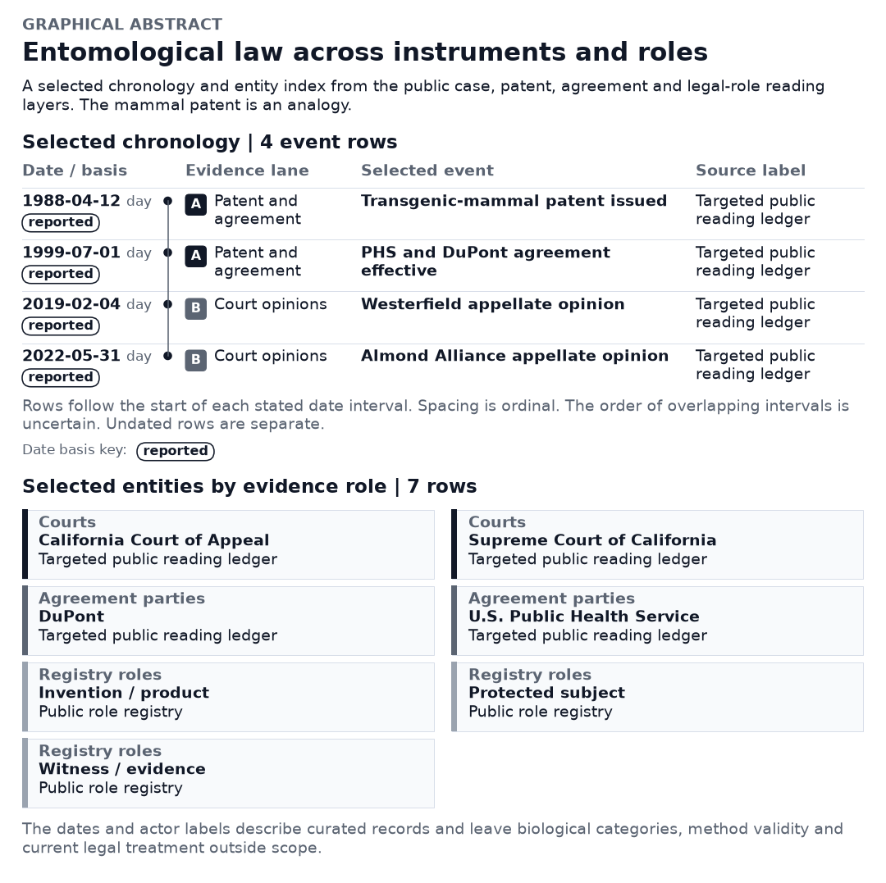

# Abstract: A Source-Anchored Map of Entomological Law {#sec:abstract}

There is no statute, treatise, or law-school casebook titled "Entomological Law." The phrase names a *synthetic field* — the convergence zone where the six-legged world repeatedly forces the legal system to answer questions it was not designed for: *Can a fly testify? Who owns a swarm? Is a bumblebee a fish? Can you patent a mosquito? May a court excommunicate a weevil? Does a cricket suffer? May insects be used in war?* This reference compiles that field as a machine-readable and reproducible artifact organized around the legal *role* an insect occupies in a given dispute. It encodes 8 legal roles — witness, regulated threat, protected subject, property, invention, defendant, moral patient, and weapon — and binds to them 18 curated case and patent entries, 43 statutes and treaties across 9 categories and 10 jurisdictions, 24 insect taxa, 13 certifying and regulatory institutions, 44 historical milestones spanning 3676 years, and 5 cross-domain themes that knit the roles together. Every count in this prose is generated from the source registries under `src/`, legal propositions are source-bound in the bibliography, every externally-sourced statistic written as a numeral is bound to a verification record in the claim ledger, and every figure caption is emitted from a source-owned caption registry. The result is both a map of a genuinely transdisciplinary field and a reproducibility contract: the same version-controlled inputs regenerate the inventories, validation report, analytical figures, manuscript variables, and paper while preserving explicit caveats about registry scope, jurisdictional reach, and the boundary between what the offline gates prove and what only a live source check can confirm.

# Graphical abstract

{#fig:graphical_abstract_v1 latex-placement=H}

Entomological law across instruments and roles

A selected chronology and entity index from the public case, patent, agreement and legal-role reading layers. The mammal patent is an analogy.

**Selected chronology (4 event rows)**

- 1988-04-12 (day, reported) — Patent and agreement — Transgenic-mammal patent issued — source Targeted public reading ledger.
- 1999-07-01 (day, reported) — Patent and agreement — PHS and DuPont agreement effective — source Targeted public reading ledger.
- 2019-02-04 (day, reported) — Court opinions — Westerfield appellate opinion — source Targeted public reading ledger.
- 2022-05-31 (day, reported) — Court opinions — Almond Alliance appellate opinion — source Targeted public reading ledger.

Rows follow the start of each stated date interval. Spacing is ordinal. The order of overlapping intervals is uncertain. Undated rows are separate.

**Selected entities by evidence role (7 rows)**

- Courts — California Court of Appeal — source Targeted public reading ledger.
- Courts — Supreme Court of California — source Targeted public reading ledger.
- Agreement parties — DuPont — source Targeted public reading ledger.
- Agreement parties — U.S. Public Health Service — source Targeted public reading ledger.
- Registry roles — Invention / product — source Public role registry.
- Registry roles — Protected subject — source Public role registry.
- Registry roles — Witness / evidence — source Public role registry.

The dates and actor labels describe curated records and leave biological categories, method validity and current legal treatment outside scope.
