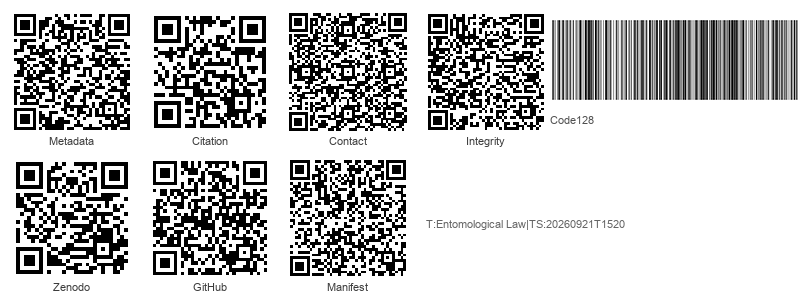
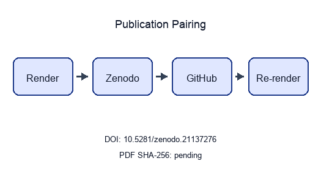
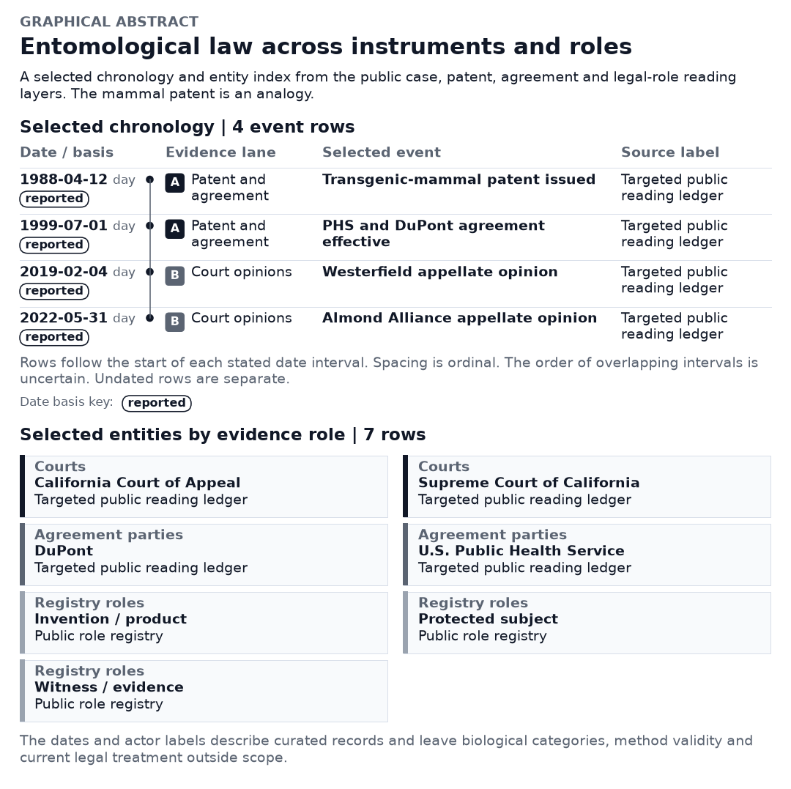

```{=latex}
\thispagestyle{empty}
\setlength{\parskip}{0pt}
\setlength{\itemsep}{0pt}
\begin{samepage}
\scriptsize
```

```{=latex}
\section*{BEGINNING OF TRANSMISSION}\label{beginning-of-transmission}
```

**State:** unpublished / pending pairing

**Pairing:** pending — unresolved:
- ✗ GitHub release URL: `pending`
- ✗ PDF SHA-256: `pending`

```{=latex}
\subsubsection*{Release metadata}
```

| Field | Value |
| --- | --- |
| Title | Entomological Law |
| Version | 1.0.0 |
| Concept DOI | 10.5281/zenodo.21137276 |
| GitHub | docxology/EntoLaw |
| Zenodo | [https://zenodo.org/records/21137276](https://zenodo.org/records/21137276) |
| SHA-256 | pending |
| SHA-512 | pending |

```{=latex}
\subsubsection*{How to verify}
```

- Scan **Integrity** QR and compare the embedded SHA-256 prefix to the table above.
- Scan **Zenodo** / **GitHub** QR codes and confirm they resolve to this release pairing.
- Full hashes and structured fields: `../data/transmission_manifest.json`.

{width=98%}

Structured manifest: `../data/transmission_manifest.json`

{width=35%}

```{=latex}
\end{samepage}
\newpage
```


<!-- BEGINNING OF TRANSMISSION -->


---


# Abstract: A Source-Anchored Map of Entomological Law {#sec:abstract}

There is no statute, treatise, or law-school casebook titled "Entomological Law." The phrase names a *synthetic field* — the convergence zone where the six-legged world repeatedly forces the legal system to answer questions it was not designed for: *Can a fly testify? Who owns a swarm? Is a bumblebee a fish? Can you patent a mosquito? May a court excommunicate a weevil? Does a cricket suffer? May insects be used in war?* This reference compiles that field as a machine-readable and reproducible artifact organized around the legal *role* an insect occupies in a given dispute. It encodes 8 legal roles — witness, regulated threat, protected subject, property, invention, defendant, moral patient, and weapon — and binds to them 18 curated case and patent entries, 43 statutes and treaties across 9 categories and 10 jurisdictions, 24 insect taxa, 13 certifying and regulatory institutions, 44 historical milestones spanning 3676 years, and 5 cross-domain themes that knit the roles together. Every count in this prose is generated from the source registries under `src/`, legal propositions are source-bound in the bibliography, every externally-sourced statistic written as a numeral is bound to a verification record in the claim ledger, and every figure caption is emitted from a source-owned caption registry. The result is both a map of a genuinely transdisciplinary field and a reproducibility contract: the same version-controlled inputs regenerate the inventories, validation report, analytical figures, manuscript variables, and paper while preserving explicit caveats about registry scope, jurisdictional reach, and the boundary between what the offline gates prove and what only a live source check can confirm.

# Graphical abstract

{#fig:graphical_abstract_v1 latex-placement=H}

Entomological law across instruments and roles

A selected chronology and entity index from the public case, patent, agreement and legal-role reading layers. The mammal patent is an analogy.

**Selected chronology (4 event rows)**

- 1988-04-12 (day, reported) — Patent and agreement — Transgenic-mammal patent issued — source Targeted public reading ledger.
- 1999-07-01 (day, reported) — Patent and agreement — PHS and DuPont agreement effective — source Targeted public reading ledger.
- 2019-02-04 (day, reported) — Court opinions — Westerfield appellate opinion — source Targeted public reading ledger.
- 2022-05-31 (day, reported) — Court opinions — Almond Alliance appellate opinion — source Targeted public reading ledger.

Rows follow the start of each stated date interval. Spacing is ordinal. The order of overlapping intervals is uncertain. Undated rows are separate.

**Selected entities by evidence role (7 rows)**

- Courts — California Court of Appeal — source Targeted public reading ledger.
- Courts — Supreme Court of California — source Targeted public reading ledger.
- Agreement parties — DuPont — source Targeted public reading ledger.
- Agreement parties — U.S. Public Health Service — source Targeted public reading ledger.
- Registry roles — Invention / product — source Public role registry.
- Registry roles — Protected subject — source Public role registry.
- Registry roles — Witness / evidence — source Public role registry.

The dates and actor labels describe curated records and leave biological categories, method validity and current legal treatment outside scope.


---


# Mapping Entomological Law: Roles, Evidence, and Limits {#sec:introduction}

"Entomological law" — or, from the other direction, "legal entomology" — is not a single discipline but a multi-domain complex in which insects and their biology touch legal norms at dozens of points. A bibliometric analysis of the research literature found that "forensic entomology" and "legal entomology" are used interchangeably and span well over a thousand articles across more than a hundred contributing countries [@magana2019bibliometric]. This reference treats the field in a broad sense: domains in which insects become objects or instruments of legal regulation.

Recent animal-law scholarship now names "insect law" directly, but this reference uses "entomological law" to keep the lens wider than animal-welfare doctrine: the same organism may enter evidence, quarantine, conservation, food, biotechnology, and weapons law before moral status is even at issue [@reddy2025insect_law].

The deeper connective problem is that courts and agencies repeatedly need insect biology to become what science-and-law scholarship calls a serviceable truth: reliable enough for action, bounded enough to expose uncertainty, and explicit enough to be revisited when the evidence changes [@jasanoff2015serviceable]. Forensic entomology translates larval development into time; quarantine law translates ecological risk into movement controls; conservation law translates population decline into listing decisions; welfare law translates sentience evidence into moral and statutory thresholds. The same epistemic move recurs across the field.

The second connective problem is classification. Classification systems are not neutral filing cabinets: they allocate visibility, responsibility, and institutional action [@bowker1999sorting]. Insects reveal that point with unusual force because they move across ordinary legal boundaries so easily. A fly can be an expert's clock, a statutory animal, a constitutional hook, or a nuisance depending on which classificatory gate opens first. The field therefore also depends on boundary-work: courts and agencies must decide when entomology is sufficiently scientific for evidence, sufficiently uncertain for precaution, sufficiently economic for trade restrictions, or sufficiently moral for welfare concern [@gieryn1983boundary_work; @jasanoff2004states_of_knowledge].

## The role model: what law needs insects to be

The field has no master statute and no single agency, yet it coheres. Its organizing principle is the **legal status the insect occupies in a given dispute**. The same organism is, in turn, a witness, a regulated threat, a protected subject, property, an invention, a defendant, a moral patient, or a weapon — and each role poses a question the legal system was not built to answer. The 8 roles, their domains, and their core questions are listed below and visualized with their registry evidence in the roles-overview figure.

| Legal role of the insect | Domain | Core question |
|---|---|---|
| Witness / evidence | Forensic entomology | When did death occur, and where? |
| Regulated threat | Quarantine & invasive-species law | May this organism cross a border? |
| Protected subject | Conservation / endangered-species law | Does the state owe this species survival? |
| Property | Common law of wild animals | Who owns this swarm, hive, or specimen? |
| Invention / product | IP, biotech & food law | Can this insect be patented, engineered, or eaten? |
| Defendant | Historical animal trials | Can a pest be tried and punished? |
| Moral patient | Emerging welfare & sentience law | Can an insect be wronged? |
| Weapon | International humanitarian law & biosecurity | May insects be used in war? |

![The 8 registered legal roles an insect can occupy in this release, with the case, statute, species, and milestone evidence encoded for each. Read as: the field is not one doctrine but a set of recurring legal positions that biology can trigger. Why it matters: the figure sets the manuscript's organizing grammar before the doctrinal sections specialize it. Provenance: `src/roles.py` and `src.metrics.role_coverage_matrix()`. Caveat: counts describe the encoded registries, not the entirety of each legal sub-field.](../figures/roles_overview.png){#fig:roles_overview width=95%}

## How the roles cohere: a preview

The 8 roles above are not silos; the registry also encodes 5 recurring themes that cut across them, and that synthesis is worth seeing before the per-role sections rather than only after them. The network below previews the connective tissue @sec:interconnections unpacks in full: it is the map the rest of this reference keeps returning to, so it is placed here as an orientation figure rather than left to surface only at the end.

![Network of the 5 recurring themes that link the legal roles — the definitional problem, the expert-testimony bridge, the biotechnology pivot, the property/conservation mirror, and the ancient/modern rhyme. Edge bundles share a theme colour. Read as: category changes, not species names, are what move a dispute from one legal regime into another. Provenance: `src/interconnections.py`. Why it matters: the synthesis depends on transfers among categories rather than parallel lists of topics. Caveat: the graph encodes declared thematic links, not statistical association.](../figures/role_interconnections.png){#fig:role_interconnections width=85%}

## Why the registry comes first

A typical survey of this material mixes prose summaries of statutes with anecdotes of famous cases; both rot quickly as section numbers are recodified and holdings are distinguished. This reference inverts that pattern. Every legal role, case, statute, taxon, institution, and milestone cited in the prose comes from a Python registry under `src/`, and every count — "18 cases", "43 statutes", "24 taxa" — is a double-brace token resolved at build time by `src.manuscript_variables.generate_variables`. The discipline this enforces is the same reproducibility model the wider template uses: a count that drifts from its registry cannot reach a green PDF without the manuscript-token closure test flipping red first (@sec:methods).

## A legal history from bee swarms to gene drives

The field is old in more than one way. Its property lineage now reaches back before Rome: the Hittite Laws tariff stolen bees and bee hives, Mishnah Bava Batra treats bees as both beehive property and neighbor-law risk, and Roman law then turns swarms into the classic problem of wildness, sight, and pursuit [@hittite_laws_bees; @mishnah_bava_batra2_10_bees; @mishnah_bava_batra5_3_beehive; @justinian533; @justinian_digest41]. That lineage also passes through successor-kingdom and East Slavic tariff law: the Salic Law makes stolen bees a named theft subject, Rothari's Lombard code distinguishes an apiary vessel from bees taken out of a marked tree, and *Ruskaia Pravda* protects bort signs, bee trees, and removed bees as legally priced forest-apiculture injuries [@lex_salica_bees; @edictum_rothari_bees; @ruskaia_pravda_bees]. Muscovite law then makes the valuation still more granular: the 1649 *Sobornoe Ulozhenie* separately prices bee trees with and without bees, removed colonies, stolen hives, and deliberate destruction [@sobornoe_ulozhenie1649_bees]. Medieval English restatements such as *Fleta* then carry the occupation problem forward, while the evidentiary lineage begins with the 1235 Sickle Murder recounted by Song Ci in *The Washing Away of Wrongs* (1247), where flies settling on an apparently clean blade exposed invisible blood and forced a confession; the claim is bound here both to a Library of Congress record for the Chinese text and to McKnight's scholarly English translation [@fleta1290_bees; @songci1247; @songci_mcknight1981]. Its product-law lineage is old as well: early colonial instruments treated mulberries, silk inputs, silks, and wax as objects of public economic policy rather than merely private agricultural choices [@virginia_assembly1619_mulberry; @carolina_charter1663_silks_wax]. A Russian and Russian-Imperial threat-law lineage also begins before professional society infrastructure: a 1749 Senate decree made locust extermination a provincial administrative duty, Pallas's 1781 *Icones Insectorum* made insects of Russia and Siberia a taxonomic object, and later the chartered Russian Entomological Society, Keppen's harmful-insect compendium, and Danilevsky's phylloxera commission report show insect expertise entering administrative governance before modern plant-health law [@russian_senate1749_locust_belgorod; @pallas1781_icones_insectorum; @russian_entomological_society1864_charter; @keppen1881_harmful_insects; @danilevsky1882_phylloxera]. From there the registry traces 44 milestones across 3676 years — bee property, medieval animal trials, colonial silk policy, succession-based time-of-death estimation, eighteenth- and nineteenth-century pest administration, twentieth-century conservation and biotechnology statutes, and twenty-first-century sentience and gene-drive debates shown in the timeline figure.

![Selected milestones of entomological law across the 3676-year span the registry encodes, from early bee-theft and bee-property rules to the 2026 monarch-listing suit, coloured by legal role. Read as: old evidentiary and property problems keep reappearing inside new biotechnology, welfare, and conservation disputes. Why it matters: the chronology shows recurrence rather than novelty as the field's basic pattern. Provenance: `src/timeline.py`. Caveat: a selected chronology, not a comprehensive history.](../figures/timeline.png){#fig:timeline width=98%}

The same arc appears twice in this reference, for two different reasons. The timeline above shows the milestones the law itself created; the figure below shows the sources that document them — every bibliography entry with a parseable date, not just the ones that became milestones. Reading the two side by side up front makes an honesty point before any doctrinal argument starts: the evidence base is not a thin modern layer with a few decorative antiquities, it has real pre-modern depth, and @sec:methods explains exactly how that bibliography is validated.

![Date distribution for every bibliography entry with a parseable year, split into broad bands and individual source-date strips with pre-1700 and 1700-1999 layers separated from the 2000+ consolidation, including labelled pre-1800 Rus', Muscovite, and Russian-Imperial legal/scientific sources plus pre-1950 Russian and Soviet entomology/legal sources. Read as: EntoLaw's evidence base is anchored by early legal, regulatory, and treatise sources but interpreted through modern scholarship, cases, statutes, and official materials. Why it matters: the figure makes the historical depth of the citation stack visible instead of leaving it implicit in the reference list. Provenance: `docs/manuscript/references.bib` parsed by `legal_informatics.viz_citation_dates`. Caveat: the date is the bibliography year, so modern editions appear at edition date unless the bibliography declares a source-date anchor. The PHS-DuPont memorandum has no stated publication year; it stays n.d. in the bibliography and is not placed on the date axis.](../figures/citation_dates.png){#fig:citation_dates width=95%}

## Boundaries of the field map

This reference is a map, not a treatise. The registries are curated to anchor each role with its leading authorities, not to enumerate every decision, instrument, or species; the figures throughout describe the *encoded registries*, and their captions state that scope explicitly. Sections @sec:witness through @sec:weapon treat each role in turn; @sec:interconnections revisits the synthesis figure above in full, theme by theme; and @sec:methods documents the reproducibility contract, the claim ledger, and the honesty boundary behind the citation-date figure above.


---


# The Insect as Witness: Forensic Entomology in Court {#sec:witness}

Forensic entomology is the oldest evidentiary and most legally mature corner of the field: the use of arthropod evidence — chiefly necrophagous blow flies (Calliphoridae) colonizing remains — to estimate the **post-mortem interval (PMI)**, detect corpse movement, prove neglect, and recover toxicology from larvae. Of the 8 legal roles, the witness role is the most case-driven: 5 of the roles carry modern reporter case law, and the witness role alone accounts for 6 of the 18 registered case and patent entries, as shown in the case-by-role and jurisdiction figures.

{#fig:cases_by_role width=85%}

{#fig:cases_by_jurisdiction width=80%}

## From larvae to minimum postmortem interval

Entomologists generally calculate a **minimum PMI** — the time since first colonization — using accumulated degree-days, summing temperature above a developmental threshold and matching it to species-specific growth tables. For older remains they fall back on the succession model of arthropod waves first systematized by Jean-Pierre Mégnin in *La Faune des Cadavres* [@megnin1894]. Catts and Goff's 1992 review marks the pre-*Daubert* professionalization point: forensic entomology was already being synthesized as a legal-scientific field around PMI, succession, collection, environmental temperature, and casework limits before reliability gatekeeping became the modern evidentiary idiom [@catts_goff1992_forensic_entomology]. A sub-branch, entomotoxicology, recovers drugs and metals from maggots when blood and tissue are gone — substances that themselves distort larval growth and so must be accounted for in the estimate. The foundational legal text remains Greenberg and Kunich's *Entomology and the Law*, written expressly to prepare both the entomologist and the trial lawyer for the courtroom [@greenberg2004].

## Admissibility: Frye, Daubert, and Rule 702

Insect testimony enters US courts through the same gates as all scientific evidence. Under *Frye* the technique must be "generally accepted" in its field [@frye1923; @cornell_frye]; under *Daubert* the trial judge is a reliability gatekeeper weighing testability, peer review, error rate, acceptance, and fit [@daubert1993]; and *Kumho Tire* extends that inquiry to all expert testimony [@kumho1999]. Federal Rule of Evidence 702 codifies the requirement that reliable principles be reliably applied to the facts [@cornell_fre702]. That chronology matters: the pre-2000 source base shows a discipline with articulated methods before the courtroom asked the *Daubert* question, so the recurrent dispute is not whether insect succession can ever be law-relevant but whether the expert controlled the biological assumptions in the case at hand. In the reported authorities encoded here, disputes focus less on excluding forensic entomology wholesale than on *application* — wrong geographic dataset, microsite temperature error, species misidentification — and whether reliable principles were reliably applied to the case facts.

## Cases where insect evidence mattered

The registry pins the field's evidentiary arc from the 1235 Sickle Murder forward. Bergeret's original *Annales d'hygiène publique et de médecine légale* report is the Western hinge: he treated pupae, larvae, and metamorphosis as medico-legal evidence for a mummified newborn's time of death, making insect development part of a judicial fact pattern rather than a natural-history aside [@bergeret1855_infanticide]. Mégnin then systematized the succession model in a dedicated forensic monograph before modern expert-evidence doctrine existed [@megnin1894]. The modern arc runs through the Buck Ruxton "Jigsaw Murders" that produced the first UK conviction by entomology [@nhm_maggots], the Pennsylvania Supreme Court's affirmation of PMI testimony in *Commonwealth v. Auker* [@auker1996], the Canadian *R. v. Truscott* reversal decades after conviction [@truscott2007], and the Kirstin Lobato exoneration built on the telling *absence* of blowfly colonization, which proved death after dark [@innocence_lobato]. The targeted opening of *People v. Westerfield* records affirmance and the defense's reliance on entomological evidence; it does not establish how the jury weighed competing experts [@depth_westerfield]. A claim about juror reasoning requires evidence beyond the appellate disposition.

## Standards, certifiers, and error controls

Certification in North America runs through the American Board of Forensic Entomology (ABFE) [@abfe_cert]. The registry encodes 4 forensic-entomology institutions, including the ABFE, the European Association for Forensic Entomology (EAFE), the North American Forensic Entomology Association (NAFEA), and the National Institute of Standards and Technology (NIST) Organization of Scientific Area Committees (OSAC) task group. The National Research Council's 2009 report discusses the scientific basis of forensic methods, validation and performance, error assessment, peer review and bias [@nas2009forensic]. The targeted publisher extracts support those methodological concerns; they establish no comparative validation ranking for entomology against pattern-matching disciplines. In this project, a review should record which biological model was validated, under what conditions, with what uncertainty and how it was applied. No current field-wide level of compliance with those requirements is established here. EAFE's peer-reviewed best-practice guideline and field-wide research roadmaps frame the remaining work as a chain-of-custody, sampling, preservation, identification, reporting, and basic-to-applied research problem rather than a single admissibility rule [@amendt2007bestpractice; @tomberlin2011roadmap]. Recent global case-report scholarship makes the same point in procedural form: forensic entomology needs comparable reports because litigation turns on whether biological inference can be audited after the fact [@kotze2021case_report]. OSAC's proposed standard for collecting and preserving terrestrial entomological evidence makes the same standardization frontier concrete, shifting the problem from whether protocols can be specified to how consistently investigators apply them [@osac2025entomological_evidence].


---


# The Insect as Threat: Quarantine, Invasion, and Vector Control {#sec:threat}

Where forensic law asks insects to *speak*, regulatory law tries to *stop them from moving*. The architecture is dense and federal. In the registry the threat role is statute-driven rather than case-driven: it is anchored by 18 instruments spanning the quarantine and public-health categories, summarized in the statutes-by-category figure.

{#fig:statutes_by_category width=85%}

## US quarantine authority and plant-pest movement

The modern statute sits on a nineteenth-century administrative architecture rather than a blank slate. Britain's Destructive Insects Act made Colorado beetle an object of border prohibition, crop destruction, entry on land, official records, compensation, and penalties [@destructive_insects1877]. Across North America, L. O. Howard's 1898 USDA compilation shows states and provinces already translating insect damage into inspection offices, plant-trade controls, public-nuisance abatement, and model legislation before a national plant-quarantine statute existed [@howard1898_injurious_insect_laws]. California's 1897 horticulture act is the sharpest example: scale insects, codling moth, and other destructive orchard pests could trigger county horticultural boards, entry and inspection, notice to eradicate or destroy eggs and larvae, summary abatement as a public nuisance, county-paid costs, and liens on the infested premises [@california_horticulture1897]. India's Destructive Insects and Pests Act later cast insects, fungi, and other crop pests as import and interprovincial-movement risks [@india_destructive_insects1914]. Britain's Plant Health Act 1967 then consolidated the 1877-1927 pest-law lineage, defining pests broadly enough to include insects at any life stage and preserving landing-control and destruction powers for articles likely to introduce a pest [@uk_plant_health1967]. In the United States, the Federal Insecticide Act treated insect-killing chemistry as a misbranding and adulteration problem in commerce, while the Plant Quarantine Act gave USDA authority over import exclusion, interstate quarantine, inspection, disinfection, certification, and a Federal Horticultural Board that included the Bureau of Entomology [@federal_insecticide1910; @plant_quarantine1912]. The point is analytical: before modern environmental law, insect threat was already split among border control, local crop police powers, chemical-product integrity, federal entomology, and property-backed abatement.

Russian and Soviet sources add a second route into the same architecture, and the route starts before the Soviet state. A 1749 Governing Senate decree on locusts in Belogorod Province ordered local authorities to trample and burn newly emerged swarms, plow breeding places, use smoke and noise against flying locusts, and report repeatedly to the Senate; in that instrument the insect is not just a crop injury but an administrative emergency with provincial labor, animal power, fire, plowing, ritual, courier, and reporting dimensions [@russian_senate1749_locust_belgorod]. Pallas's 1781 *Icones Insectorum Praesertim Rossiae Sibiriaeque Peculiarium* adds the scientific bridge: insects of Russia and Siberia became objects that imperial natural history could name, illustrate, and compare before later agricultural law asked which named species required control [@pallas1781_icones_insectorum]. The Russian Entomological Society's 1864 charter then made entomology a recognized expert institution; Keppen's 1881-1883 *Vrednye nasekomye*, issued through the Department of Agriculture and Rural Industry, translated harmful insects into an administrative catalogue of species, crops, and control problems; and Danilevsky's 1882 phylloxera commission report framed an insect as a contagion-like object of eradication, customs control, host-plant destruction, and quarantine [@russian_entomological_society1864_charter; @keppen1881_harmful_insects; @danilevsky1882_phylloxera]. Uvarov's 1921 revision of *Locusta* then made locust swarming a problem of phase, periodicity, and migration rather than a mere episodic plague; that entomological move helps explain why a Soviet decree could treat locust control in the USSR-Afghanistan borderlands as an administrative and diplomatic problem [@uvarov1921_locusta_phase; @snk_locust_afghanistan1934]. Pavlovsky's natural-focality doctrine did comparable work for vector-borne disease: ticks, mosquitoes, and other arthropod vectors became parts of landscape-specific disease foci that public-health authorities could map, surveil, and manage [@pavlovsky1939_natural_focality; @pavlovsky1946_vector_nidality]. The comparative point is that Russian entomological governance was administrative before it was Soviet and ecological before it was environmental. Law did not merely name a pest; it borrowed from natural history and entomology to decide which institution, movement, landscape, host plant, or vector relation should trigger state action.

The master contemporary statute is the Plant Protection Act, cited here at 7 U.S.C. §§ 7701–7786, which empowers the U.S. Department of Agriculture's Animal and Plant Health Inspection Service (APHIS) to prohibit movement, declare quarantines, require permits, and seize or destroy infested articles [@ppa2000; @usc7_7712]. Moving a live insect interstate or importing one requires an APHIS permit and an approved containment facility. The rogues' gallery of regulated pests is encoded in the species registry: the spotted lanternfly under active quarantine [@aphis_slf], the Asian longhorned beetle under eradication, the emerald ash borer whose *federal* quarantine was lifted in 2021, and the northern giant hornet — the "murder hornet" — declared eradicated from the United States in 2024, the first *Vespa* eradication in North America [@guardian_hornet].

## International, IPPC, and EU risk layers

Above the US sits the International Plant Protection Convention, whose International Standards for Phytosanitary Measures (ISPMs) serve as the benchmark under the World Trade Organization (WTO) Agreement on the Application of Sanitary and Phytosanitary Measures (SPS Agreement) for judging whether a quarantine is science-based or a disguised trade barrier [@ippc_ispm]. IPPC's pest-status standard makes pest records, status categories, and uncertainty part of the legal infrastructure for deciding whether a pest is present in an area [@ippc_ispm8]. The European Union (EU) runs its own priority-pest list and plant-passport system under the Plant Health Law [@eu2016_2031]. The EU also treats invasive alien species as a separate Union-wide risk category: Regulation (EU) 1143/2014 creates a Union list whose species face restrictions on keeping, importing, selling, breeding, growing, and release, and the European Commission says the fourth update of that list entered into force on 7 August 2025 [@eu1143_2014; @ec_ias2026].

That architecture makes invasive-insect law a risk-allocation system, not merely a list of pests. The legal decision is whether uncertain ecological evidence justifies stopping trade, seizing property, requiring treatment, or spending public money on surveillance and eradication. Bioeconomic scholarship on invasive species frames that choice as an institutional problem of pathways, probabilities, expected harms, and management cost under uncertainty [@lodge2016bioeconomics_invasive_species]. Insects make the problem unusually sharp because the same shipment, nursery stock, package, or animal wound can be legally ordinary until an expert identifies a life stage, pathway, or reproductive risk that moves it into quarantine law.

## Liability gaps when pest movement is indirect

The Lacey Act's injurious-species provision at 18 U.S.C. § 42 is a strict-liability criminal statute, but it conspicuously **does not list insects**, deferring to the Plant Protection Act for plant pests and leaving non-plant-pest insects in a regulatory gap [@lacey42; @crs_lacey]. Recent enforcement marks the limits of secondary liability: in *Amazon Services LLC v. USDA* the D.C. Circuit held that aiding or inducing a regulated-pest movement requires conscious and culpable participation, not mere fulfilment services [@amazon2024]. And in a Minnesota tree-infestation suit the claim failed for lack of an entomological expert — proof that forensic and regulatory entomology converge, because invasive-pest causation cannot be shown without expert insect testimony [@minnlawyer_lac].

## Vectors as public-health infrastructure

The same regulatory logic extends to insects as disease vectors. California has operated mosquito-abatement and vector-control districts since 1915 under a statute declaring organized public programs the best protection against vector-borne disease [@ca_vector_hsc2001], and federal mosquito-control funding has been advanced as national public-health law [@asthovector]. International animal-health law adds a standards layer: WOAH's Terrestrial Code includes a chapter on surveillance for arthropod vectors of animal diseases, showing how vector law crosses animal health, human health, and trade [@woah_vector_surveillance]. This vector-control strand is where the threat role brushes against the weapon role of @sec:weapon.


---


# The Insect as Protected Subject: Conservation and Recovery Law {#sec:protected}

The mirror image of quarantine law: instead of exterminating insects, the state guarantees their survival. The species registry encodes 6 taxa in the protected role — from the Schaus swallowtail, among the first insects ever listed, to the rusty patched bumble bee, the monarch, and the American burying beetle, summarized in the species-by-role figure.

![The 24 registered taxa grouped by the legal role they illustrate, from forensic blow flies to quarantined pests, listed species, owned honey bees, engineered and edible insects, the trial weevils, and a weaponized flea. Read as: the same biological class can become evidence, asset, enemy, product, or rights candidate depending on legal context. Why it matters: legal role, not species identity alone, determines which institution acts. Provenance: `src/species.py`. Caveat: an illustrative set chosen to anchor each role, not a taxonomic survey.](../figures/species_by_role.png){#fig:species_by_role width=85%}

## The ESA definition that reaches arthropods

The federal Endangered Species Act (ESA), cited here at 16 U.S.C. § 1531, defines "fish or wildlife" to expressly include any "arthropod or other invertebrate," putting non-pest insects within the statute's eligibility frame [@esa1973; @usc16_1532]. Conservation-law scholarship has treated that textual inclusion as more than a curiosity: it is the doctrinal opening through which ecologically central but politically obscure organisms can become federal legal subjects [@lugo2006insect_conservation_esa]. Recent conservation science now reviews invertebrate listing history and threats as an ESA problem in its own right, reinforcing that insects are not merely edge cases inside vertebrate-centered conservation law [@shirey2025invertebrate_esa]. Among the first insects listed was the Schaus swallowtail in 1976 (with the Bahama swallowtail); the Delhi Sands flower-loving fly, listed in 1993, became the first and only fly — and the unlikely protagonist of a constitutional landmark.

## Commerce Clause protection for tiny species

In *National Association of Home Builders v. Babbitt*, cited at 130 F.3d 1041, developers argued Congress lacked Commerce Clause power over a fly that lives entirely within California; a divided panel upheld the protection, and legal scholarship quickly recognized the Delhi Sands flower-loving fly as a test of whether tiny, local, economically inconvenient species could carry national ecological value [@homebuilders1997; @nagle1998delhi]. The "take" prohibition reaches habitat modification under *Babbitt v. Sweet Home*, so insect habitat enjoys the same protection as the insects themselves [@sweethome1995]. State law is widening the institutional map as well: Colorado's invertebrate conservation law adds rare plants and invertebrates to its nongame conservation statute and authorizes voluntary programs to conserve, protect, and perpetuate invertebrates [@co_hb24_1117].

## State law and the bumblebee-as-fish problem

In *Almond Alliance of California v. Fish & Game Commission*, cited at 79 Cal.App.5th 337, the Court of Appeal interpreted the statutory definition at Fish & Game Code § 45 to permit terrestrial invertebrates to qualify under CESA's listing and candidate provisions when their other requirements are met [@depth_almond]. This is a rule of statutory scope, not a biological classification or proof of current listing. The reviewed primary copy is the original opinion on counsel's institutional host; later treatment is not newly verified here. The monarch butterfly was proposed for threatened listing in 2024; as of June 29, 2026, the U.S. Fish and Wildlife Service (FWS) still described the species as proposed and said protections would not apply until a final rule became effective [@fws2024monarch; @fws_monarch_status].

## Trade, pollinators, and insect decline

The Convention on International Trade in Endangered Species of Wild Fauna and Flora (CITES) supplies the trade-law counterpart: its official checklist identifies *Ornithoptera alexandrae* — Queen Alexandra's birdwing — as an insect with current listing I, and domestic implementing legislation then makes covered trade legal, sustainable, and traceable [@cites1973; @cites_checklist2026]. The global biodiversity layer broadens the frame: the Kunming-Montreal Global Biodiversity Framework gives insect conservation a treaty-scale target architecture, while insect-focused conservation scholarship warns that existing biodiversity indicators may fail to show whether policy is actually recovering insect populations unless insect-focused indicators are built [@cbd_gbf2022; @bladon2026gbf_insect_conservation]. EU conservation law is now more explicit about pollinators as a protected infrastructure: the Nature Restoration Regulation sits alongside the EU Pollinators Initiative, and the European Commission says that EU policy commits to reversing wild-pollinator decline by 2030 while reporting that 1 in 3 bee, butterfly, and hoverfly species is proven to be in decline and 1 in 10 bee and butterfly species is threatened with extinction [@eu_nature_restoration2024; @ec_pollinators2026]. Driving all of this is the science of the "insect apocalypse": a landmark study found a decline of more than 75 percent — a 76 percent seasonal and 82 percent mid-summer fall — in flying-insect biomass over 27 years of monitoring in protected areas [@hallmann2017], a finding amplified by global reviews and scientists' warnings about entomofauna decline and its interacting pressures [@sanchezbayo2019; @wagner2021insectdecline; @cardoso2020scientists_warning]. The legal-protection gap is now measurable as well as rhetorical: a 2026 PNAS study reports that the conservation status of 88.5 percent of described North American insect and arachnid species is unknown, while 94.7 percent of U.S. insects and arachnids at-risk throughout their range are not protected by any state or federal law [@esa_position2021; @pnas2026insects].

The legal difficulty is that insect value is often infrastructural rather than charismatic. Pollination, pest suppression, nutrient cycling, waste processing, and food-web support are ecological services before they are individualized legal interests, which means law must translate diffuse background work into administrable species, habitat, trade, and take decisions [@losey2006economic_value_insects]. That translation explains why this role touches both property and threat: the same insect can be valuable enough to protect in one setting and disruptive enough to suppress in another.


---


# The Insect as Property: Bees, Specimens, and Qualified Possession {#sec:property}

When an insect is neither evidence, threat, nor protected subject, it may simply be *owned*. No insect has generated more property law than the honeybee, and the registry pins 5 decisions to this role.

## Capture, hiving, pursuit, and possession

The oldest directly verified property layer is not Roman. The Hittite Laws treat stolen bees in a swarm and stolen bee hives as tariffed wrongs, while Hittite apiculture scholarship shows that honey and bees were economic and ritual resources inside a wider cuneiform record [@hittite_laws_bees; @demirel2022_hittite_apiculture]. Mishnah Bava Batra adds a legal-contract layer: a sold beehive carries the bees in it, and beehive produce is handled through swarms and honeycombs [@mishnah_bava_batra5_3_beehive]. Roman law then classed bees as *ferae naturae* — wild by nature, owned only through capture and lost when they abandon the *animus revertendi*, the intention to return, a legal gloss on the real swarming and absconding behavior of honeybee colonies [@johnson2023honeybeebiology]. The Institutes say a swarm on another's tree is not owned until hived, while the Digest adds the pursuit rule that a swarm leaving a hive remains the keeper's only while it is visible and not difficult to follow [@justinian533; @justinian_digest41]. Early medieval law did not merely repeat that Roman template. The Salic Law gives stolen bees their own theft title, while Rothari's Lombard code separates theft from an apiary vessel from taking bees out of another person's marked tree; those clauses make enclosure, marking, and woodland claim legible before the later common-law vocabulary arrives [@lex_salica_bees; @edictum_rothari_bees]. The Russian line is not derivative background. *Ruskaia Pravda* punishes destruction of bort signs, cutting of bee trees, and removal of bees, while the 1649 *Sobornoe Ulozhenie* separately values a bee tree with bees, a tree without bees, removed bee colonies, stolen hives with bees, and deliberate destruction of a hollow bee tree [@ruskaia_pravda_bees; @sobornoe_ulozhenie1649_bees]. That distinction matters: Muscovite law could price the insect colony, the marked arboreal habitat, and the hive-like human apparatus as separable legal harms. Early Irish *Bechbretha* is a separate legal technology rather than a mere parallel: its bee judgments organize hives, swarms, bee trespass penalties, and distraint of bees, so the insect is at once livestock, neighbor-law hazard, and distrainable object [@bechbretha_bee_judgments; @bechbretha1983]. Bracton repeats the hiving and pursuit rules in English legal vocabulary; *Fleta* gives the same occupation rule in medieval English legal Latin, using bees to show that enclosure and practicable pursuit matter more than mere presence on the owner's land; and the Welsh laws give both valuation rules for bee stocks and swarms and recovery rules for bees that enter another person's skep [@bracton_bees_thorne; @fleta1290_bees; @welsh_laws1841_bees]. Recent scholarship on early medieval apiculture captures the broader shift: successor-kingdom legislation often moved bees from pure wildness toward beekeeper property, while comparative Indo-European scholarship treats Hittite, Irish, and later bee-law parallels as suggestive but not proof of a single inherited rule [@martinez_jimenez2022_apiculture_law; @joseph2018_comparative_bee_law]. Blackstone then carried the Roman structure into common-law commentary, describing hived and reclaimed bees as qualified property under natural and civil law [@blackstone1766_bees]. The common law also carried the broader wild-animal doctrine forward through the Case of Swans [@caseofswans1592]. The leading modern English authority, *Kearry v. Pattinson* at [1939] 1 KB 471, holds that there is **no right to pursue a swarm onto a neighbour's land** [@kearry1939]; the leading American authority, *Goff v. Kilts* at 15 Wend. 550, recognizes a **qualified property** in bees so long as the owner keeps them in sight and pursues them [@goff1836].

That doctrine is not just a bee-specific oddity. Property theory has long treated possession as a communicative act: the would-be owner must give the world a recognizable signal that a thing has been appropriated [@rose1985possession_property]. Bees strain that theory because the signal is biological and relational rather than purely physical. A hive, a marked box, visible pursuit, disease records, and apiary registration all become ways of making mobile insects legible as property.

The same source line also reaches tithe and fiscal argument. Selden's *Historie of Tithes* and Elderfield's later defense of tithes both preserve the bee clause as part of a wider early-modern debate over whether profit from bees belongs with woods, meadows, waters, mills, fisheries, gardens, and trade [@selden1618_tithes_bees; @elderfield1650_tythes_bees]. That matters analytically because it moves bees from possession alone into accounting: law is not only asking who captured the swarm, but which institution can claim a share of the bee-derived yield.

## Neighbor disputes, regulation, and liability

The neighbor-injury pattern is much older than modern apiary statutes. Mishnah Bava Batra's mustard-and-bees rule places bees inside neighbor-law distance doctrine, and Bava Batra's later discussion makes the conflict reciprocal: one side can complain about mustard harming bees, while the other can complain about bees eating mustard plants [@mishnah_bava_batra2_10_bees; @talmud_bava_batra18a_bees]. Quintilian's legal declamation imagines a poor beekeeper whose bees die after a rich neighbor poisons flowers, framing the loss as wrongful damage rather than a mere natural misfortune [@quintilian_decl13_bees]. Soviet apiculture supplies a modern comparative bridge: Markushkin's 1927 legal handbook for beekeepers, catalogued as answering legal questions from Soviet apiarists, shows bee ownership becoming an advice-and-administration problem inside early Soviet agricultural life [@markushkin1927_beekeeper_legal_handbook]. Modern law translates that same problem into regulation and tort. The federal Honeybee Act restricts bee importation, and states layer apiary registration, disease protocols, and Africanized-bee controls on top [@honeybee1922]. Keeping bees near neighbours carries tort exposure: in *Ferreira v. D'Asaro* a Florida court addressed liability for sting injuries from hives maintained close to a residential property line [@ferreira1963]. The same property/tort logic reaches the structures insects damage — a pest-control firm faced professional liability for a negligent wood-destroying-insect inspection in *Horsch v. Terminex* [@horsch1993]. Bees are now serious crime targets as well: within California's almond-pollination economy, large-scale hive thefts have been prosecuted as agricultural or livestock theft.

## Owned honeybees and protected wild bees

The honeybee one can own and the rusty patched bumble bee the state now protects (@sec:protected) sit on opposite ends of the same *ferae naturae* doctrine — a mirror symmetry taken up directly in @sec:interconnections.


---


# The Insect as Invention and Product: Biotech, Food, Feed, and Silk {#sec:invention}

The newest frontier: insects deliberately engineered, patented, farmed, and eaten. The registry pins 3 case and patent entries and 5 taxa to this role, from the Oxitec mosquito to the house cricket, the yellow mealworm, the black soldier fly, and the silkworm.

## Patents for engineered living things

The registry anchors this role in *Diamond v. Chakrabarty*, cited at 447 U.S. 303, and *Ex parte Allen* [@chakrabarty1980; @exparteallen1987]. The Harvard OncoMouse patent supplies an issued claim to a specified transgenic non-human mammal [@depth_oncomouse]. That grant is not a judicial validity ruling and cannot alone establish an insect invention's eligibility, validity or claim coverage. The particular claim, instrument and jurisdiction require examination; a category label cannot replace that analysis.

## Engineered mosquitoes and gene drives

The 1986 Coordinated Framework splits jurisdiction over genetically modified insects among the Environmental Protection Agency (EPA), APHIS, and the Food and Drug Administration (FDA) [@coordinated1986]. The flagship case is Oxitec's engineered *Aedes aegypti*, released in the Florida Keys under an EPA experimental-use permit [@oxitec_epa]. WHO guidance now supplies the public-health testing baseline for genetically modified mosquitoes, emphasizing safe, ethical, and rigorous staged evaluation before deployment [@who_gm_mosquitoes2021]. EPA's current pesticide-law posture is correspondingly procedural and risk-pathway specific: its FIFRA Scientific Advisory Panel materials ask how to determine the absence of novel proteins in the saliva of genetically engineered female mosquitoes, while a May 27, 2026 EPA fact check stated that the prior experimental-use permit had expired and that no genetically engineered mosquito releases were then authorized in the United States [@epa_ge_mosquito_sap2025; @epa_ge_mosquito_factcheck2026]. **Gene drives** — constructs that force inheritance through wild populations — are governed by general biosafety and biotechnology instruments rather than a deployment-specific insect regime, a governance mismatch emphasized by early regulatory proposals, consensus reports, and responsible-innovation scholarship [@oye2014gene_drives; @cartagena2000; @nasem2016genedrives; @fisher2018genedrives]. A later implementation review for gene-drive modified mosquitoes sharpens the institutional point: product definition, transboundary movement, market entry, and the role of national, regional, and multinational authorities are design questions, not late-stage paperwork [@james2023gene_drive_policy]. The Sterile Insect Technique underpins the screwworm-eradication program, which re-entered the U.S. legal and veterinary agenda when New World screwworm was confirmed in a calf in Zavala County, Texas, on June 3, 2026; the Texas Animal Health Commission later described an established infested zone, quarantine limits on movement of warm-blooded animals, and joint federal-state surveillance and response work [@tahc_nws2026].

## Insect food and feed as regulated markets

The EU leads via the Novel Food Regulation, cited at Regulation (EU) 2015/2283, which has authorized several insect products — house cricket, yellow mealworm, migratory locust, and lesser mealworm among them — each through an individual implementing regulation and European Food Safety Authority (EFSA) opinion [@eu2015_2283; @ec_insect_novel_foods2026]. Comparative food-law scholarship treats the EU's authorization model as unusually explicit relative to many national systems [@lahteenmaki2021insectfoodfeed]. The United Nations food-and-feed literature supplies the policy backdrop: insects are framed simultaneously as food security infrastructure, waste-conversion technology, and farmed animals [@fao2013edible_insects]. The pre-2000 US record already carried the central ambiguity: FDA's 1988 wheat-filth compliance guide used the adulteration provision to police insect-damaged grain, while DeFoliart's *Food Insects Newsletter* and 1999 review framed entomophagy as a food-security, ecological, and cultural-bias question rather than simply a contamination problem [@fda_cpg_wheat_filth1988; @food_insects_newsletter1988; @defoliart1999_insects_as_food]. The US does not have a single insect-food pathway comparable to the EU's novel-food authorizations: edible insects sit awkwardly between the adulteration and "filth" provisions of the Food, Drug, and Cosmetic Act and the Generally Recognized as Safe (GRAS) framework [@ffdca342; @fda_defect_levels]. But US state law is beginning to name insect protein as a product category: Utah's H.B. 138 requires labeling for foods containing plant or insect-based meat substitutes, making insect substitutes legible as alternative-protein products rather than mere contaminants [@utah_hb138_2025]. On the feed side, the EU has progressively relaxed its post-bovine spongiform encephalopathy (BSE) feed ban to admit processed insect protein, beginning with aquaculture [@eu2017_893]. A recent EU legal-barriers study adds a live-feed boundary: SCoPAFF clarified that live insects may be used as feed in the EU except for ruminants [@ziety2026_insect_farming_barriers].

## Genetic resources, silk, and colonial development

Bioprospecting insect venom peptides, antimicrobials, and silk proteins implicates the Nagoya Protocol's sovereignty and benefit-sharing duties [@nagoya2010]. Sericulture is a historically deep regulatory domain in its own right: Virginia's first assembly already made mulberry planting and silk-flax work a legal development duty, Hartlib's Virginian silk-worm pamphlet framed silkworm rearing and mulberry planting as public industry, Virginia's later mulberry-tree act continued that statutory infrastructure, and the Carolina charter treated silks and wax as duty-favored colonial commodities [@virginia_assembly1619_mulberry; @hartlib1655_silkworm; @virginia_mulberry1658; @carolina_charter1663_silks_wax]. Georgia Trustee records show the same administrative impulse in practice, tracking public mulberry nurseries and settler progress in silk culture, while Atlantic-world sericulture scholarship explains why imperial administrators kept trying to make silkworm cultivation a development program [@egmont_georgia_trustees1736; @marsh2020_england_virginia_sericulture; @marsh2020_lower_south_sericulture]. India's Central Silk Board Act continues that pattern by making quality-controlled silkworm biology a matter of statutory public interest [@csb1948]. This domain loops back to conservation (the biotechnology value of species was a Commerce Clause hook in @sec:protected) and forward to welfare (@sec:welfare), since industrial insect farming raises animals at a scale no prior welfare regime contemplated.


---


# The Insect as Defendant: Animal Trials and Legal Ritual {#sec:defendant}

Across late medieval and early modern Europe, courts literally **prosecuted insects**. This is the field's most astonishing chapter, and its most history-driven: the registry encodes no modern reporter case for the defendant role, but 5 timeline milestones and the trial weevils themselves carry it. The source base now has a clearer pre-1700 core rather than only a nineteenth-century retrospective layer. Chasseneuz's 1581 consilia place insect prosecution inside learned legal opinion; Bailly's 1668 treatise on monitories and a pleading against insects shows the genre persisting as a procedural form; Ménabréa's 1846 Savoy academy study and Evans's 1884 Atlantic article then organize and translate that archive for modern readers [@chasseneuz1581_consilia; @bailly1668_monitoires_insectes; @menabrea1846_animal_judgments; @evans1884_bugs_beasts; @evans1906; @beirne1994_evans].

## Chassenée and the prosecuted weevils

The jurist Bartholomew Chassenée built his career defending vermin and wrote the first legal treatise on insect prosecution. His own consilia matter because they move the argument upstream from antiquarian retelling into pre-1700 legal reasoning: the insect problem is framed through summons, representation, competent forum, sentence, and the distinction between anathema and excommunication [@chasseneuz1581_consilia]. Evans's 1884 account remains useful because it treats the Chassenée episode as law rather than folklore: notice, default, counsel, jurisdiction, judge, and forum all matter before any malediction can issue [@evans1884_bugs_beasts]. Ménabréa supplies the complementary French documentary frame, including the St-Julien materials and a preserved "plea for the insects" that makes the insects procedurally visible even though they remain nonrational pests [@menabrea1846_animal_judgments]. Bailly's later pleading against insects tightens the point: early modern procedure could script advocacy around insect populations without making insects ordinary moral agents or rights-bearing persons [@bailly1668_monitoires_insectes]. The vine-weevils of St-Julien were first treated as a divine scourge and later met with a proposed preserve for the insects; earlier proceedings against the slugs of Autun round out the registry's defendant milestones [@evans1906].

## What animal trials reveal about modern law

These trials are not merely curiosities. They separate **procedure** from **personhood** with unusual clarity: the court can stage notice, representation, and sentence around an insect population without deciding that insects possess moral agency or ordinary legal capacity. That is why the defendant role matters to modern law. The 1587 offer of a land preserve for the weevils foreshadows modern **critical-habitat designation** (@sec:protected), and the medieval debate over whether an animal can be a defendant prefigures the modern debate over whether it can be a *rights-holder* (@sec:welfare). Entomological law repeatedly uses legal form to manage biological agency: the insect can be summoned, protected, patented, quarantined, or excluded before the legal system has a stable theory of what kind of subject it is. The defendant role is thus the historical hinge of the field's two most forward-looking questions, a connection drawn out in @sec:interconnections.


---


# The Insect as Moral Patient: Sentience, Welfare, and Legal Standing {#sec:welfare}

The field's living edge. The question is no longer whether an insect can testify or be owned, but whether it can be *wronged*. The registry pins 1 taxon to this role as an exemplar — the fruit fly — and grounds the role in emerging legislation rather than reporter case law.

## Sentience evidence and statutory expansion

The pre-2000 baseline was already explicit but cautious: Eisemann and coauthors asked whether insects feel pain and treated nociception, neural organization, behavior, and learning as biological tests that did not map neatly onto vertebrate pain doctrine [@eisemann1984_insect_pain]. A London School of Economics (LSE) review later built a multi-criterion sentience framework from a large body of studies [@lse_birch2021]. The UK Animal Welfare (Sentience) Act 2022, cited at Animal Welfare (Sentience) Act 2022, acted on it: its interpretation section defines "animal" to include any vertebrate other than humans, any cephalopod mollusc, and any decapod crustacean, and reserves a regulatory power to extend coverage to other invertebrates [@uksentience2022]. The Animal Sentience Committee now makes the insect question institutionally visible: in January 2026 it said discussions around animal sentience were gathering momentum for some insects and arachnids, and recommended clear processes for reviewing sentience evidence so legislation can be updated in time [@uk_asc_definitions2026]. The US Animal Welfare Act draws the opposite boundary from within federal animal-welfare law: USDA describes the statutory definition as centered on named taxa and other warmblooded animals, leaving insects outside that baseline [@usda_awa2026]. Strikingly, the comparative-evidence literature finds that adult flies and cockroaches satisfy a majority of the established sentience criteria — scoring higher than some of the very decapods the Act already covers — and has begun to ask whether routine insect research should itself adopt welfare review [@gibbons2022; @crump2023insectwelfare]. Recent ethical scholarship pushes the same debate beyond proof of pain alone, arguing that precaution and intrinsic value can matter when invertebrate sentience remains hard to demonstrate conclusively [@desouzavalente2025invertebrate_sentience].

## Exclusion, scale, and the farmed-insect problem

EU law shows the same exclusion. Directive 2010/63/EU, governing animals in scientific procedures, systematically leaves out insects [@eudir2010_63], and the Treaty on the Functioning of the European Union (TFEU)'s recognition of animals as "sentient beings" is not self-executing and in practice protects almost exclusively vertebrates [@tfeu_art13]. The stakes are scale: Rethink Priorities estimates that roughly 1 trillion to 1.2 trillion insects are raised on farms annually for food and feed, prompting farmed-insect welfare proposals that must move beyond sentience alone to slaughter, stocking density, handling, and environmental conditions [@rethink_farmed_insects; @vanhuis2021welfare; @barrett2023farmed_insect_welfare]. Animal-law critique of insect-based agriculture adds a second warning: sustainability framing can obscure industrial scale, feed-chain substitution, and welfare costs rather than resolving them [@reddy2024insect_agriculture]. The legal imagination is broader still: the path from property to personhood runs through proposals for living-property status, rights for natural objects, legal personhood at the boundaries of biological and artificial agency, and evolutionarily inclusive ethics [@favre2010living_property; @stone1972trees; @rowe2025insect_ai_personhood; @mikhalevich2020minds]. This domain is the philosophical counterweight to the commercialization of @sec:invention — the same industrial farming that food and feed law encourages is what welfare law now scrutinizes.


---


# The Insect as Weapon: Vectors, Crops, and International Humanitarian Law {#sec:weapon}

Finally, insects as instruments of war, biosecurity, and international humanitarian law (IHL). The registry carries this role through 3 historical milestones and 1 taxon — the plague-bearing oriental rat flea — rather than through litigation.

## Entomological warfare before biotechnology

Japan's Unit 731 conducted plague-flea air-drops; the Ningbo attack of 1940 alone caused major civilian casualties, with broader operations linked to large-scale civilian deaths. Cold War programs followed, including the US Operation Big Itch, which tested uninfected-flea dispersal.

## Treaty limits and dual-use insects

The Biological Weapons Convention (BWC), cited at Biological Weapons Convention (1972), treats insect vectors as covered means of delivery under its General Purpose Criterion, though ambiguity persists around uninfected insects used in crop warfare [@bwc1972]. That ambiguity erupted publicly over the Defense Advanced Research Projects Agency (DARPA)'s "Insect Allies" program, which proposed using insects to deliver protective genes to crops; a 2018 critique in *Science* argued the dual-use technology risked violating the Convention, a charge the program disputed [@science2018insectallies]. Domestically, the Agricultural Bioterrorism Protection Act classifies certain plant pests as select agents subject to stringent possession and transfer rules [@agbioterror2002]. Insect-warfare law thus connects to the gene-drive debates of @sec:invention — the same biotechnology read alternately as agriculture and as weapon, and loosely overseen by the Cartagena Protocol [@cartagena2000].


---


# Interconnections: How Insects Move Between Legal Roles {#sec:interconnections}

The 8 roles are not silos. They share recurring legal machinery, encoded as the 5 themes previewed in the interconnections network figure at the start of this reference and unpacked theme by theme below. The role-coverage matrix makes the field's structure visible at a glance: some roles are case-driven, some statute-driven, and some — the defendant and the weapon — almost entirely history-driven.

![Heatmap of how much evidence each role carries across the four registry kinds (cases, statutes, species, milestones), making the field's case-driven, statute-driven, and history-driven corners visible at a glance. Read as: a role can be legally central even when its evidence is historical or statutory rather than case-law dense. Why it matters: the figure prevents case-counts from standing in for the whole legal architecture. Provenance: `src.metrics.role_coverage_matrix()`. Caveat: cell values are registry counts, not weights of legal importance.](../figures/role_coverage.png){#fig:role_coverage width=80%}

The themes, and the roles each links, are catalogued below.

| Theme | Roles linked | Description |
|---|---|---|
| The definitional problem | Witness / evidence, Regulated threat, Protected subject, Property, Invention / product, Defendant, Moral patient, Weapon | Entomological law is, at root, a series of fights over what category a bug belongs to: is a bumblebee a 'fish', a screwworm a 'plant pest', a fly 'wildlife', an insect 'made by man', a cricket 'sentient'? |
| Expert testimony binds forensic and regulatory law | Witness / evidence, Regulated threat | Proving invasive-pest causation requires the same entomological expertise as proving time of death — a tree-infestation suit failed for lack of an insect expert. |
| Biotechnology is the pivot point | Invention / product, Protected subject, Weapon, Moral patient | GM and gene-drive insects are simultaneously regulated products, conservation tools or threats, potential weapons, and moral patients in farmed-welfare debates. |
| Property and conservation are mirror images | Property, Protected subject | Roman and common-law bee possession rules sit opposite modern bumblebee protection under the same ferae naturae doctrine. |
| The ancient and the cutting-edge rhyme | Defendant, Protected subject, Moral patient | Roman bee pursuit, Irish bee trespass, and the 1587 weevil preserve foreshadow modern fights over habitat, rights, and legally actionable insect status. |

- **The definitional problem** runs through everything: is a bumblebee a "fish" (@sec:protected), a screwworm a "plant pest" (@sec:threat), a fly "wildlife" (@sec:protected), an insect "made by man" and patentable (@sec:invention), or "sentient" (@sec:welfare)? Entomological law is, at root, a series of fights over what category a bug belongs to.
- **Expert testimony binds forensic and regulatory law**: proving invasive-pest causation requires the same entomological expertise as proving time of death (@sec:witness, @sec:threat).
- **Biotechnology is the pivot point**: engineered and gene-drive insects are simultaneously regulated products, conservation tools or threats, potential weapons, and moral patients (@sec:invention, @sec:protected, @sec:weapon, @sec:welfare).
- **Property and conservation are mirror images**: the honeybee one can own (@sec:property) and the bumblebee the state protects (@sec:protected) sit on opposite ends of the same *ferae naturae* doctrine, a line running from Hittite, rabbinic, Salic, Lombard, Rus', Muscovite, and Irish bee clauses through Justinian, Fleta, and Blackstone to modern listing law [@hittite_laws_bees; @mishnah_bava_batra5_3_beehive; @lex_salica_bees; @edictum_rothari_bees; @ruskaia_pravda_bees; @sobornoe_ulozhenie1649_bees; @bechbretha_bee_judgments; @justinian533; @fleta1290_bees; @blackstone1766_bees].
- **The ancient and the cutting-edge rhyme**: Hittite hive theft, rabbinic bee nuisance, Roman bee pursuit, Irish bee trespass, Quintilian's poisoned-flower bee claim, Chasseneuz's insect-process consilium, and the St-Julien weevil proceedings all foreshadow modern fights over habitat, rights, and legally actionable insect status (@sec:defendant, @sec:protected, @sec:welfare) [@hittite_laws_bees; @mishnah_bava_batra2_10_bees; @justinian_digest41; @bechbretha_bee_judgments; @bechbretha1983; @quintilian_decl13_bees; @chasseneuz1581_consilia; @bailly1668_monitoires_insectes; @menabrea1846_animal_judgments; @evans1884_bugs_beasts].

The connective tissue is not metaphorical. It is a recurring translation from biological fact to legal status. A larva becomes a clock; a mosquito becomes either public-health infrastructure or a releaseable regulated article; a fly becomes wildlife; a cricket becomes food, feed, and possibly a welfare subject. That is why the same evidentiary problem appears in unrelated doctrinal settings: law needs science to produce action-ready, reviewable claims without pretending uncertainty has disappeared [@jasanoff2015serviceable]. The Delhi Sands flower-loving fly made that problem constitutional, the EU Union list makes it administrative, the gene-drive debate makes it anticipatory, and the farmed-insect welfare debate makes it industrial [@nagle1998delhi; @ec_ias2026; @oye2014gene_drives; @barrett2023farmed_insect_welfare].

The deeper arc is status migration. Wild animals begin as unowned things, become qualified property when captured, become protected subjects when scarcity matters, become products when engineered or eaten, and become rights candidates when sentience or ecological standing enters the frame. The pre-modern sources show that this migration is not new: bees were already stolen swarms, hive contents, neighbor-law hazards, marked-tree resources, tithable yields, trespassers, distrainable objects, and objects of neighborly remedy before modern conservation and biotech vocabularies existed, while colonial silk and wax instruments show insect-derived commodities becoming public economic policy before modern biotechnology law had a name [@hittite_laws_bees; @mishnah_bava_batra5_3_beehive; @mishnah_bava_batra2_10_bees; @lex_salica_bees; @edictum_rothari_bees; @ruskaia_pravda_bees; @sobornoe_ulozhenie1649_bees; @bechbretha_bee_judgments; @selden1618_tithes_bees; @elderfield1650_tythes_bees; @virginia_assembly1619_mulberry; @carolina_charter1663_silks_wax]. The animal-trial sources add a separate lesson: legal procedure can organize a conflict around insects even when doctrine refuses to treat insects as morally accountable persons [@chasseneuz1581_consilia; @bailly1668_monitoires_insectes; @menabrea1846_animal_judgments; @evans1884_bugs_beasts]. Legal scholarship on living property and standing for natural objects helps explain why insects are such good stress tests: they sit at the edge of every familiar boundary while remaining biologically central to ecosystems, agriculture, evidence, and public health [@favre2010living_property; @stone1972trees; @cardoso2020scientists_warning; @fao2013edible_insects].

The hard cases also show why entomological law cannot be reduced to "nature law" or "animal law." A quarantine officer, a forensic expert, a conservation biologist, a food regulator, and a welfare theorist are often looking at the same biological fact but asking different institutional questions: admissibility, movement risk, extinction risk, market authorization, or moral considerability. Scholarship on invasive-species risk analysis, insect conservation, comparative food-and-feed regulation, and invertebrate ethics supplies the missing bridge: each field has built a translation apparatus for moving from uncertain insect science to a legal decision [@lodge2016bioeconomics_invasive_species; @lugo2006insect_conservation_esa; @lahteenmaki2021insectfoodfeed; @mikhalevich2020minds]. The pre-2000 layer now does analytic work across that bridge rather than serving as background color: Rus' and Muscovite bee clauses show property law distinguishing colony, marked tree, and hive; the Russian Senate's locust decree shows a swarm converted into provincial administrative work; Pallas shows Russian and Siberian insects becoming taxonomic objects; the Russian Entomological Society shows expert authority becoming chartered infrastructure; Keppen shows harmful insects being organized as a Department-of-Agriculture problem; Danilevsky's phylloxera report turns eradication, customs control, host-plant destruction, and quarantine into a legal-political choice; Uvarov turns locust movement into a population-state and border-control problem; Markushkin shows beekeeping as Soviet legal advice; Pavlovsky turns arthropod vectors into landscape-governance units; Catts and Goff show witness science professionalizing before *Daubert*; the Plant Health Act shows pest-police powers being consolidated before contemporary biosecurity; FDA wheat-filth guidance and DeFoliart show edible insects divided between contaminant and resource; and Eisemann gives welfare law its pre-statute biological question [@ruskaia_pravda_bees; @sobornoe_ulozhenie1649_bees; @russian_senate1749_locust_belgorod; @pallas1781_icones_insectorum; @russian_entomological_society1864_charter; @keppen1881_harmful_insects; @danilevsky1882_phylloxera; @uvarov1921_locusta_phase; @snk_locust_afghanistan1934; @markushkin1927_beekeeper_legal_handbook; @pavlovsky1939_natural_focality; @pavlovsky1946_vector_nidality; @catts_goff1992_forensic_entomology; @uk_plant_health1967; @fda_cpg_wheat_filth1988; @defoliart1999_insects_as_food; @eisemann1984_insect_pain].

The newest sources sharpen that bridge. The Global Biodiversity Framework turns insect recovery into an indicator problem, because global targets cannot protect insects if monitoring systems do not detect insect-specific decline or recovery [@cbd_gbf2022; @bladon2026gbf_insect_conservation]. Utah's alternative-protein labeling statute shows the same classification work in market form: a cricket or mealworm ingredient must be named differently from conventional meat before consumer-protection law can act on it [@utah_hb138_2025]. In both settings, the legal question is not whether an insect exists; it is which institutional vocabulary makes the insect actionable.

The registry itself makes that classification work explicit. Each row asks what role the insect is playing, which institution is authorized to notice it, and what legal consequence follows from that notice. That mirrors scholarship on classification infrastructure and science/society co-production: the categories do not merely describe insects after law has acted; they help determine which facts can become legal facts in the first place [@bowker1999sorting; @jasanoff2004states_of_knowledge]. The insect becomes legally real when the right boundary is drawn around the right expertise, whether that boundary is a Daubert hearing, a quarantine perimeter, a listing rule, a patent claim, or a welfare threshold [@gieryn1983boundary_work].


---


# Methods: Registry-First, Claim-Ledgered Legal Synthesis {#sec:methods}

This reference is built so that the map and the evidence cannot drift apart. All domain knowledge lives in 7 source-of-truth registries under `src/` — roles, cases, statutes, species, institutions, timeline, and interconnections — and every reader-facing artifact is regenerated from them, as shown in the architecture figure.

![How 7 source-owned registries become reproducible outputs. Pure generator methods — metrics, validation, manuscript-variable generation, and figure rendering — turn registry data into inventories, reports, figures, and the rendered manuscript itself. Read as: the package treats the manuscript as a compiled artifact, not as the source of legal facts. Why it matters: readers can audit whether prose, visuals, and counts share the same inputs. Provenance: `src/viz.py`. Caveat: a local build-pipeline description, not a deployment diagram.](../figures/architecture.png){#fig:architecture width=95%}

## Token closure: every count comes from code

Every magnitude-bearing number in this prose is a double-brace token (a `TOKEN` wrapped in doubled braces) resolved at build time by `src.manuscript_variables.generate_variables`. The closure test asserts that every token referenced in the manuscript is generated and that the generator emits no orphan, so a registry edit that changes a count (say, adding a case) updates the prose automatically, and a hand-typed count that drifts from its registry fails the build. The 43 statutes span 10 jurisdictions, shown in the statutes-by-jurisdiction figure; that number, like the 18 registry entries and the 14 registered inventory figures, is generated, never typed.

![The same 43 instruments partitioned by issuing jurisdiction — US-federal, US-state, US-colonial, UK, India, Muscovy, Russian Empire, USSR, EU, and international — showing the field's multi-level legal architecture. Read as: insect law is built through stacked authority, with local movement rules, national statutes, and international instruments all operating at once. Why it matters: no single legal layer owns the field's risk decisions. Provenance: `src/statutes.py`. Caveat: jurisdiction is the issuing level, not a measure of reach or enforcement.](../figures/statutes_by_jurisdiction.png){#fig:statutes_by_jurisdiction width=80%}

## Claim ledger, validation, and reproducibility

Counts come from the registries; *external* and volatile current-status claims do not. Each externally-sourced statistic written as a numeral, and each date-sensitive status claim that the manuscript needs to preserve, is registered in `data/claim_ledger.yaml` with a verification record: the source URL, a verbatim supporting quote, an as-of date, a confidence label, and the date the check was last run. The current ledger contains 20 quote-backed entries, with section coverage shown in the claim-ledger coverage figure. Two oracles bind these claims. The **offline** oracle (`src.claim_ledger.validate_claim_ledger`) proves each claim is attributed to a real bibliography key, anchored to a declared section, and carries a complete, fail-closed verification block — it cannot prove a number is *true*. The **live** oracle (`tests/test_live_claim_sources.py`, run with `-m live`) fetches each source URL and confirms the recorded quotes appear, so "verified" is a re-runnable fact rather than an assertion. This boundary is deliberate and documented: the green offline gate guarantees *shape and attribution*; only the live oracle guarantees *correspondence to the source*.

![Coverage of the 20 live-checkable claim-ledger entries by declared manuscript section. Provenance: `src.claim_ledger.claim_coverage_by_anchor()`. Read as: volatile current-status and external magnitude claims are isolated where live evidence, not registry counts, carries the truth burden. Why it matters: it makes the manuscript's fact-checking boundary auditable by section. Caveat: a section with zero entries may still contain registry-derived facts or qualitative cited claims; this figure shows external/current claims that require a quote-backed verification block.](../figures/claim_ledger_coverage.png){#fig:claim_ledger_coverage width=80%}

Citations, cross-references, and statistics all pass through their own validation gates. A cross-registry validator fails closed on a malformed citation, an out-of-vocabulary role or category, a duplicate slug, or an empty required field, and writes its findings to `output/reports/validation.json`. A separate gate scans the manuscript for any numeral-form magnitude that is neither a generated token nor a value present in the claim ledger, with a negative control proving the detector fires on a planted statistic. Together these gates make the reference's central promise machine-checkable: no numeral-form statistic reaches the page unbacked. The bibliography is also treated as data. The citation-date figure, previewed at the start of this reference, parses `references.bib` directly, so the reader can see where the source base is early legal text, where it is modern scholarship, and where it is official current-status material.

## Candidate case leads (unreviewed)

A separate, clearly-bounded pass runs alongside the registries above: `scripts/fetch_case_candidate_queries.py` submits 14 declared CourtListener opinion-search queries (`config/case_candidate_queries.yaml`) against the 8 legal issues in `config/legal_issues.yaml`, and `scripts/generate_case_candidates.py` rebuilds `data/case_candidates.yaml` deterministically, offline, from the recorded responses. **Every one of the 176 rows that register holds is an unreviewed search hit, not a finding**: each carries `status: candidate`, meaning CourtListener returned it for a declared query and nothing about it has been read, weighed, or admitted. No candidate has entered `references.bib`, `data/claim_ledger.yaml`, or `src/case_records.py` by virtue of appearing here, and no function in `src/case_candidates.py` can write anything but `candidate` into that field. 7 of the 8 declared issues have at least one surfaced candidate so far, shown below by conservatively-derived court level, with filings by decade alongside.

![The 176 CourtListener case CANDIDATES the candidate-query pipeline has surfaced so far, grouped by declared legal issue and a conservatively-derived court level (supreme, appellate, trial, other/unknown), with filings by decade in the side panel. Read as: this is a lead list, not a finding -- every bar counts an unreviewed CourtListener opinion-search hit that `status: candidate` in `data/case_candidates.yaml` records and nothing more. Why it matters: it shows where the case law the manuscript has not yet reviewed is concentrated, without letting a search hit stand in for a verified authority. Provenance: `src.case_candidate_metrics` over `data/case_candidates.yaml` and `config/legal_issues.yaml`. Caveat: court level is derived from the court name string alone and is conservative -- a name this rule cannot place stays other/unknown rather than guessed; see `docs/CASE_CANDIDATES.md`.](../figures/case_candidates_by_issue.png){#fig:case_candidates_by_issue width=90%}

Promoting a candidate into an actual citation, claim, or case-record entry is a human decision made after reading the opinion, never a pipeline step — see `docs/CASE_CANDIDATES.md` for the promotion path and the boundary `tests/test_case_candidates.py` enforces around it.

Finally, this build carries its own provenance: generated on `Darwin arm64` under Python `3.15.2` from configuration hash `1ec3a8837d9f0773`, with build stamp `2026-07-02T00:00:00Z`. The stamp is not the wall clock: it is `SOURCE_DATE_EPOCH` when an outer build pins one, and otherwise the manuscript's declared date, so the same version-controlled inputs on the same platform regenerate the inventories, the figures, the manuscript variables, and this document's text and LaTeX source byte-for-byte. One exception remains outside this project: the rendering template's bookend integrity strip still stamps its barcode from the wall clock, so the rendered PDF differs between builds on its first and last pages only and is not kept under version control.

## Selected-frame statistics and visible limits

The registry frame is a curated collection of decisions and patents, rather
than a probability sample of disputes or a complete doctrinal census.
`src.registry_analysis.analyze_registry` adapts its stable entry identifiers to
the shared engine's descriptive analysis. The adjacent figure table records
exact member IDs, numerator and denominator, the mapping from generic grouping
fields to jurisdiction and registered role, and source digests. A year in the
registry retains year precision; it is not a request, event or production date.
No disclosure rate, response duration or agency comparison is inferred.

![Read as: jurisdiction by principal registered role for the selected curated decision/patent frame. Cells show exact entry counts; the adjacent JSON table retains member identifiers, denominators and source hashes. A zero means no encoded entry, not absence of doctrine or records. Why it matters: the joint table exposes the registry composition hidden by separate role and jurisdiction totals. Provenance: src/registry_analysis.py over src/case_records.py and src/roles.py through the shared descriptive engine. Caveat: authored summaries and year-only dates are not new opinion readings, request durations or a representative sample of legal disputes.](../figures/registry_frame.png){#fig:registry_frame width=95%}

The cross-tab exposes the joint composition hidden by separate role and
jurisdiction totals. A zero cell describes the encoded frame, not absence of
case law, an insect role, or agency records. The analysis protocol makes this
finite-frame estimand explicit. AAPOR's discussion of inferential assumptions
motivates that caution; using it for a curated legal registry is this project's
adaptation [@methods_aapor_nonprobability].

## Located argument review and a discriminating acquisition plan

The rhetorical codebook separates the source's proposition, grounds, scope,
qualification and an alternative explanation. Entman's selection/salience
framework offers a vocabulary for human framing memos; Grimmer and Stewart
motivate source-specific validation of computational text analysis
[@methods_entman_framing; @methods_grimmer_stewart]. These methods do not convert
a registry's authored holding summary into a freshly read opinion, or a legal
role into a claim about an agency's intent.

`config/records_research.yaml` asks role-specific questions and names candidate
record categories, alternative explanations and routing review. Forensic
validation, quarantine decisions, conservation records, property disputes,
patent files, historical process, ethics deliberation and public oversight
require different documentary tests. The declaration asserts no record's
existence and sends no request. Each proposed inference needs a located source
and a record that could also challenge it.

Custody determines the access route. Federal FOIA does not provide access to
records held by federal courts; California's judicial administrative access
rule separately distinguishes administrative and adjudicative records
[@methods_doj_foia_scope; @methods_ca_judicial_access]. An agency record about a
proceeding and the court file itself are different acquisition questions. The
public-source ledger retains current-law retrieval limits, and every request
plan requires human jurisdiction and scope review before any correspondence.

## Instrument type changes the proposition being tested

A patent grant, an appellate disposition and a statutory eligibility ruling
are different legal acts. The selected new primary readings are recorded in
`docs/research/instrument_readings.json`, with host, exact reviewed extent and
retrieval failures. No full opinion reading or present legal status is inferred
from those targeted passages.

The OncoMouse patent's front page and claim show an issued instrument and a
bounded claimed invention, not a judicial ruling that the patent is valid
[@depth_oncomouse]. The historical PHS agreement identifies patent-related use
and transfer terms; it is not a current license or validity judgment
[@depth_phsmou]. The research discriminator is the particular claim, file history
or agreement and its operative period, rather than a biological category alone.

Westerfield's opening states affirmance and describes the defense's reliance on
entomological evidence [@depth_westerfield]. That supports the disposition, not
the former registry inference that a jury discarded a field of expertise. A
stronger account would require the opinion's actual issue analysis and the
trial record: what inference was offered, what assumptions were disputed, and
what ruling resolved which objection. The source selection does not establish
how jurors reasoned or a general error rate for entomology.

Almond Alliance's introduction and conclusion address eligibility under CESA's
statutory definitions and listing requirements [@depth_almond]. That does not
make a universal biological classification or establish a species' current
listing. The primary opinion was read from the Stanford law clinic's copy;
the official opinion endpoint was unavailable. Its original disposition is
distinguished from later treatment, which this targeted reading does not verify.

| Research question | Discriminating evidence | Limit on access or inference |
| --- | --- | --- |
| Was an expert inference admitted and on what ground? | Issue, ruling, record citation and alternative explanation | A court file is not a federal-agency FOIA file |
| What does a patent instrument claim? | Exact claim, specification, prosecution and cited instrument version | Issuance alone is no judicial validity finding |
| Why did a listing decision cover a taxon? | Statutory definition, eligibility reasoning and separate listing record | Eligibility is not biological identity or current listing |
| Did an agency use a patented research tool? | A dated agreement, institutional record and custodian linkage | A historical public agreement proves no present agency holding |

No request is sent and no record's existence is presumed. Any justified
correspondence remains DRAFT — NOT SENT pending human scope and custodian review.

## A prospective review of legal propositions

EntoLaw — prospective located argument review

Unit definition: One declared source span with exact byte digest, parsed-text selector and character offsets; the unit is not a complete request or instrument.

Selection: Purposive contrasts among scope, attribution and evidentiary-linkage problems already identified in this project; not random or exhaustive and not a prevalence denominator.

Codebook version: 2026-11-06-v1

Expected codebook SHA256: 7f204c9f02c470d6db758b796f06ebb613bfb19ec6cd16bdadb34cddf54a0623. Every performed judgment must name this exact digest.

Review plan: Future reviewers would first record source kind and apply each code independently using the include/exclude rules, retaining uncertain decisions and rationales. Discuss disagreements only after preserving original independent judgments; do not backfill them from lexical cues or later consensus. No actual reviewers, independent pairs or judgments are supplied in this edition.

Declared frame: 6 located excerpts; 4 codes. Performed reviewer aliases: 0; explicit judgments: 0; declared independent pairs: 0.

Units are a declared finite excerpt frame, not a probability sample of records, agencies or rhetorical functions. Source kinds remain separate strata; overlapping or repeated passages may be dependent.

A planned review and automatic lexical cues are not human judgments. Missing assignments, explicit uncertainty and explicit absence are distinct states; none is imputed.

Each coefficient uses only the same units and codebook coded present/absent by the named pair. Uncertain or missing decisions are excluded and enumerated. Complete-case selection can distort apparent agreement.

Independence is a reviewer declaration, not an authenticated fact. Consensus/adjudicated labels must not be entered as independent judgments. Multiple coder pairs share units and are never pooled as independent observations.

Observed agreement and Cohen's kappa describe reproducibility of these coding decisions, not truth, rhetorical validity, speaker intent, search adequacy or legal compliance. No universal acceptability threshold, significance test or inferential interval is supplied.

Kappa uses coder-specific marginal proportions: (observed - expected)/(1 - expected). It is withheld for fewer than two complete pairs or expected agreement of one; marginal imbalance can make kappa diverge from raw agreement. Always inspect the contingency cells and coverage.

The operational definitions below are project-designed. Agreement and validity
are separate questions [@artstein2008]. The selected units mix authored registry
summaries with explicitly copied primary passages; they must retain those source
kinds when reviewed. No coder, independent session or judgment is supplied.

### SCOPE: Explicit scope boundary

Definition: The selected span states a time, component, record, instrument or subject boundary relevant to its proposition.

Include when: A boundary is actually stated and can be transcribed with its source kind.

Exclude when: The reviewer supplies a plausible boundary or treats a requester's proposed scope as an agency's accepted search.

Counterexample: A bare closed label states no searched locations or period.

### ACT: Attributed documentary act

Definition: The span identifies an attributed request, acknowledgment, routing, search statement, determination, grant or judicial act.

Include when: The act and its speaker or instrument can be identified from the unit's located context; keep summary attribution explicit.

Exclude when: A platform stage or reader interpretation is promoted into the underlying instrument or legal effect.

Counterexample: A task named appeal is not proof that an appeal was filed or decided.

### BRIDGE: Explicit evidentiary bridge

Definition: The span actually supplies the linkage needed for the stronger proposition under review.

Include when: The instrument's type, proposition and statutory or procedural scope are explicitly linked; issuance, adjudication and listing eligibility remain distinct.

Exclude when: A co-mention, a cultural association, a matching surname or a plausible custodian is the only connection.

Counterexample: A patent title and grant date do not establish a judicial decision on patent validity.

### QUALIFIER: Qualification of inference

Definition: The unit explicitly limits what its statement, source type or evidence supports.

Include when: A stated qualification limits the proposition; distinguish uncertainty from a definitive negative.

Exclude when: The reviewer adds a caveat that is absent from the unit or treats missing text as an explicit disclaimer.

Counterexample: The absence of a search description is not a statement that no search occurred.

### Selected excerpt depth_almond-copy

Printed page 35; line wrapping normalized, no words added. Local copy only; original bytes are not present.

Expected unit SHA256: 0ebc0fb2bb204d5f369d71ffc6cd9a323493e7a2dc786d29404dffcf408be56b.

**context; primary_passage_copy**

the Commission may list any invertebrate as an endangered or threatened species under 2062 and 2067, if the invertebrate meets the requirements of those statutes

Source: docs/research/instrument\_readings.json; pointer: /readings/1/excerpt; characters 0:161; SHA256 prefix 8a2706f0556d.

### Selected excerpt depth_oncomouse-copy

Front-page title only; not a judicial holding or a complete claim. Local copy only; original bytes are not present.

Expected unit SHA256: 707fe2d915f445b33629bf621ff4fd42f037086952b757900bc23973152bf210.

**context; primary_passage_copy**

TRANSGENIC NON-HUMAN MAMMALS

Source: docs/research/instrument\_readings.json; pointer: /readings/2/excerpt; characters 0:28; SHA256 prefix 8a2706f0556d.

### Selected excerpt depth_westerfield-copy

Printed page 1; the reviewed opening's disposition only. Local copy only; original bytes are not present.

Expected unit SHA256: 008af4d7fa79a0c32dc0ad216be4d42edef5934549e41d3b08ff5edf95ddafcc.

**context; primary_passage_copy**

We affirm the judgment in its entirety.

Source: docs/research/instrument\_readings.json; pointer: /readings/0/excerpt; characters 0:39; SHA256 prefix 8a2706f0556d.

### Selected excerpt registry-depth_almond

Authored registry holding summary; this source kind cannot authenticate an underlying instrument.

Expected unit SHA256: c40f78f33d3b8665b98dc1b02d9ea3bd58d9b0c3b3250874af09648e0f0a4add.

**context; declared_summary**

Terrestrial invertebrates can qualify for CESA listing under statutory fish definitions.

Source: src/case\_records.py; pointer: (whole text); characters 6366:6454; SHA256 prefix 63fd7026bdab.

### Selected excerpt registry-depth_oncomouse

Authored registry holding summary; this source kind cannot authenticate an underlying instrument.

Expected unit SHA256: 705b7c8e4fb4de431322c9c6520bf838ba9c4c6e347c86690253f99352659116.

**context; declared_summary**

The patent issued with claims to a specified transgenic non-human mammal.

Source: src/case\_records.py; pointer: (whole text); characters 10155:10228; SHA256 prefix 63fd7026bdab.

### Selected excerpt registry-depth_westerfield

Authored registry holding summary; this source kind cannot authenticate an underlying instrument.

Expected unit SHA256: 8a96cb678660a05a64e900b6a7dd129dc4948865d2df5439c28f599c4f7cf290.

**context; declared_summary**

The judgment was affirmed; the defense relied on entomological evidence.

Source: src/case\_records.py; pointer: (whole text); characters 3509:3581; SHA256 prefix 63fd7026bdab.

No performed reviewers or judgments declared; reliability is not assessed.

No independent coding pair declared; no agreement or kappa is estimated.

{#fig:coding_review_v1_coverage width=0.95\textwidth}

{#fig:coding_review_v1_agreement width=0.95\textwidth}


---


# Conclusion: Entomological Law as a Field Map {#sec:conclusion}

Entomological law is a genuinely transdisciplinary field whose coherence emerges not from a single statute or agency but from the biological ubiquity of insects themselves. Across the 8 roles mapped here, insects enter legal systems as evidence, as objects of protection or control, as property, as commodities and inventions, as historical defendants, as emerging welfare subjects, and as weapons — generating obligations and rights across many human–insect interactions, and tied together by 5 recurring legal devices.

Several frontiers deserve sustained attention. The **sentience question** — whether and when insects enter animal-welfare law — will likely be shaped by accumulating neuroscience, precautionary ethics, and legislative decisions in the EU and UK [@crump2023insectwelfare; @mikhalevich2020minds; @desouzavalente2025invertebrate_sentience]. The **gene-drive governance question** is a domain where deployment-specific insect governance remains thin relative to the power of the technology [@cartagena2000; @nasem2016genedrives; @fisher2018genedrives; @james2023gene_drive_policy]. And the **forensic-standardization problem** — divergent admissibility standards and uneven uptake of harmonized collection, preservation, and reporting practices — is a scientific–legal coordination failure with direct consequences for criminal justice [@amendt2007bestpractice; @osac2025entomological_evidence].

The common frontier is institutional translation. Entomological facts do not enter law raw: they are filtered through admissibility rules, quarantine thresholds, listing standards, market-authorization pathways, and moral-status tests. That makes this field a laboratory for studying how legal systems convert nonhuman life into reviewable categories without erasing biological uncertainty [@jasanoff2015serviceable; @lodge2016bioeconomics_invasive_species; @lugo2006insect_conservation_esa].

That is why the field deserves a shared name. "Entomological law" is not a claim that insects should have one code (William Blake's warning still stands: "One law for the lion and ox is Oppression" [@blake1790_marriage]). It is a claim that a recurring classificatory transaction has become visible across many codes: insects become legal actors when scientific expertise, institutional jurisdiction, and social value line up enough to support action. The same transaction appears when possession turns a swarm into property, ecosystem services turn a fly or bee into a protected subject, and sentience evidence turns a cricket or fruit fly into a candidate for moral consideration [@rose1985possession_property; @losey2006economic_value_insects; @bowker1999sorting].

The contribution of this reference is not a new doctrine but a new *substrate*: a registry-first, claim-sourced map in which every count is regenerated from source, legal propositions are source-bound in the bibliography, and every externally-sourced numeral is bound to a quotable, re-checkable source. The field has lacked its own treatise; what it most needs first is a machine-readable spine that future scholarship can extend without the map and the territory drifting apart. That spine is what this project supplies, and @sec:methods documents exactly how far its guarantees reach — and where they stop.


---


# References: Sources Cited in the Field Map {#sec:references}

::: {#refs}
:::


---


```{=latex}
% transmission-end-bookend
\clearpage
\thispagestyle{empty}
\setlength{\parskip}{0pt}
\setlength{\itemsep}{0pt}
\begin{samepage}
\scriptsize
```

```{=latex}
\section*{END OF TRANSMISSION}\label{end-of-transmission}
```

**Release:** v1.0.0 · DOI `10.5281/zenodo.21137276` · SHA-256 `pending…` · pairing pending

{width=88%}

**Prior:** `v1.0.0` · `10.5281/zenodo.21137277` · `5a189170…`

```{=latex}
\end{samepage}
```


<!-- END OF TRANSMISSION -->
